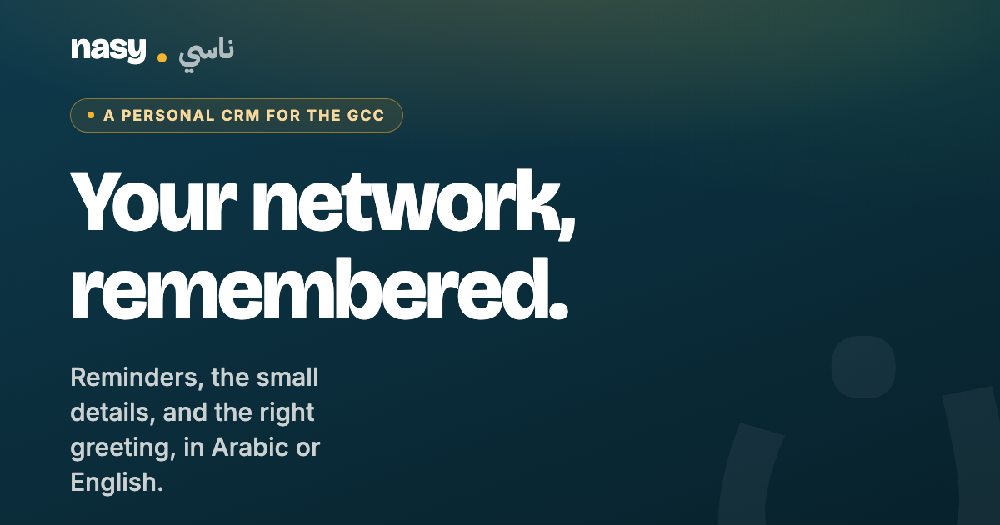

# Nasy (ناسي)

**A personal CRM for the GCC.** Nasy remembers your network for you: who you met, what matters to them, and when to reach out, with the right greeting in Arabic or English.

**Live:** [nasy.app](https://www.nasy.app) · Web app: [my.nasy.app](https://my.nasy.app)

## What it does
- Bilingual by design, with full Arabic right-to-left support and an Arabic voice standard for every screen
- Scan a business card and get a clean contact in seconds
- Two-way sync with your phone's contacts, with duplicate cleanup you can undo
- Birthday, Eid and follow-up reminders with greetings ready to send
- Shareable digital business card
- Teams edition for small Gulf sales and relationship teams

## Built with
Expo and React Native (iOS, Android, web), Fastify API, PostgreSQL, Next.js, Stripe.

## About this repo
Nasy is a commercial product, so the source code is private. This page describes the product and links to the live app.

Built by [Hiba Hassan](https://github.com/hibashassan).
